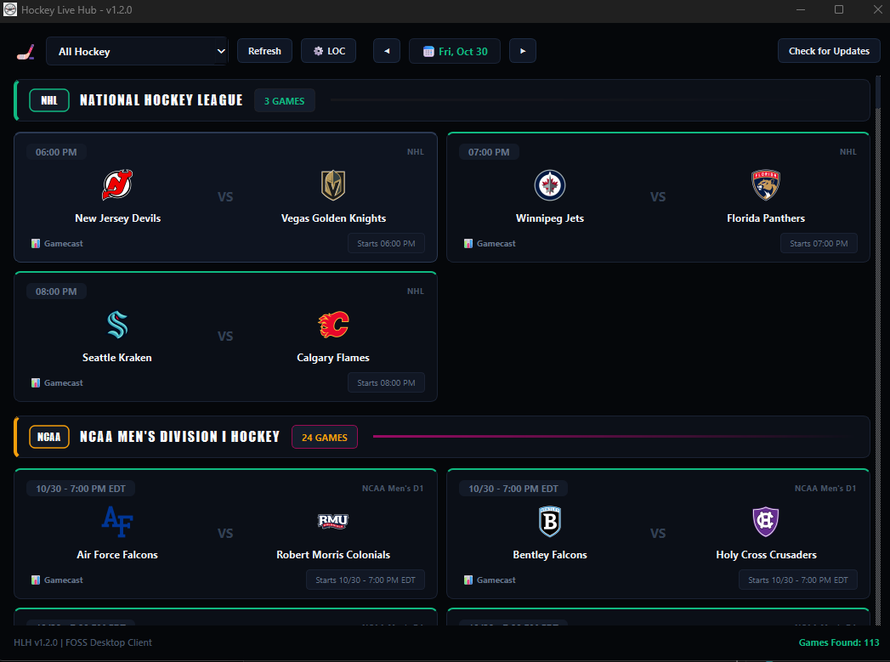

<div align="center">

# 🏒 Hockey Live Hub (HLH)

**A lightweight, ad-free desktop scoreboard and live stream launcher for hockey fans.**



[](https://github.com/pcjake22/hlh/releases/latest)

[](https://www.python.org/)
[](https://pypi.org/project/PyQt6/)
[](https://opensource.org/licenses/MIT)
[](https://buymeacoffee.com/Sadpipo)

</div>

---

## 📥 Quick Download (Windows Standalone)

Don't want to install Python or build from source? Grab the ready-to-run `.exe` directly:

👉 **[Download the Latest HockeyLiveHub.exe](https://github.com/pcjake22/hlh/releases/latest)**

1. Download `HockeyLiveHub.exe` from the latest release.
2. *(Recommended)* Ensure you have [VLC Media Player](https://www.videolan.org/vlc/) installed for ad-free direct stream playback.
3. Double-click and enjoy — no installer or dependencies required!

---

## ⚡ Features

- **Direct VLC / MPV Streaming:** Automated session resolver extracts live HLS (`.m3u8`) manifests directly from web endpoints, allowing you to watch ad-free in native media players.
- **Multi-Stream Selector:** Easily choose between direct VLC playback, clean web embeds, or aggregator search queries right from the game card.
- **Automatic Timezone Localization:** Prompts for your timezone on first launch and converts all UTC game schedules to your local time.
- **Live Multi-League Telemetry:** Direct integration with official NHL and NCAA feeds for instant scores, period tracking, and game clocks.
- **Momentum Drawer:** Interactive expandable visualizers showcasing real-time game flow and pressure metrics.
- **Condensed 10-Minute Recaps:** Instant routing to official post-game video recaps once games go final.
- **Dark Matte Interface:** Custom PyQt6 UI designed with minimal RAM overhead and zero background ad bloat.

---

## 🖥️ Supported Leagues

- **NHL** (National Hockey League)
- **NCAA Men's D1** Hockey
- **AHL** (American Hockey League)
- **ECHL** / **SPHL**
- **CHL Juniors** (OHL / WHL / QMJHL)
- **European Leagues** (Swedish SHL, Finnish Liiga, Swiss NL)

---

## 🛠️ Running from Source (Developers)

### Prerequisites

- **Python 3.10+**
- **VLC Media Player**

### Setup

1. **Clone the repository:**
   ```bash
   git clone [https://github.com/pcjake22/hlh.git](https://github.com/pcjake22/hlh.git)
   cd hlh