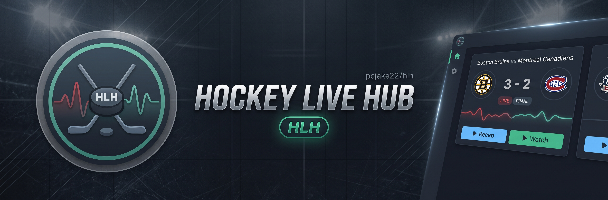

<div align="center">



# Hockey Live Hub (HLH) 🏒

A lightweight, minimalist desktop scoreboard and stream router for hockey fans. Track live games across the NHL, NCAA Men's Division 1, and global professional leagues with zero visual clutter.

<p align="center">
  <a href="https://github.com/pcjake22/hlh/releases">
    
  </a>
  
  
  
  <a href="https://github.com/pcjake22/hlh/blob/main/LICENSE">
    
  </a>
  <a href="https://buymeacoffee.com/Sadpipo">
    
  </a>
</p>

</div>

---

## ⚡ Key Features

- **Official NHL Data Feed:** Real-time scores, clock telemetry, and game states directly via the official NHL Web API.
- **NCAA Men's Division 1 & Global Leagues:** Live score coverage spanning college hockey, AHL, ECHL, SPHL, QMJHL, OHL/WHL Juniors, SHL, Liiga, and Swiss NL.
- **Direct Stream Matching:** The **Watch** button resolves direct embed links via Matchora when available and falls back smoothly.
- **Dedicated Routing:** Pro and minor league cards include a dedicated **OnHockey** button for quick alternative access; NCAA cards are streamlined to a single watch button.
- **10-Minute Condensed Recaps:** Finished games automatically display a **▶ Recap** button linking directly to official game highlights.
- **Interactive Momentum Wave:** Expandable cards reveal period-by-period scoring flow and momentum charts.
- **Native Desktop Integration:** Configured with a dedicated Windows `AppUserModelID` and custom taskbar icon.

---

## 🚀 Getting Started

### Prerequisites

- Python 3.10 or newer
- `pip`

### Installation

1. **Clone the repository:**
   ```bash
   git clone [https://github.com/pcjake22/hlh.git](https://github.com/pcjake22/hlh.git)
   cd hlh